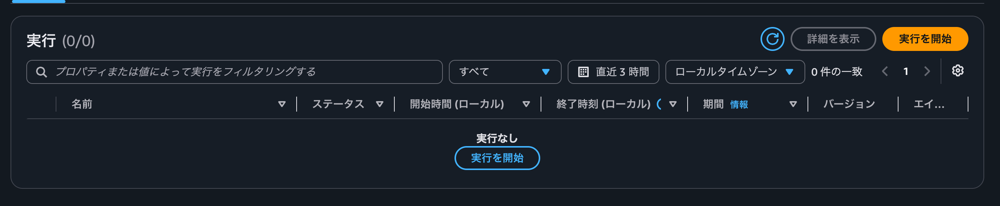
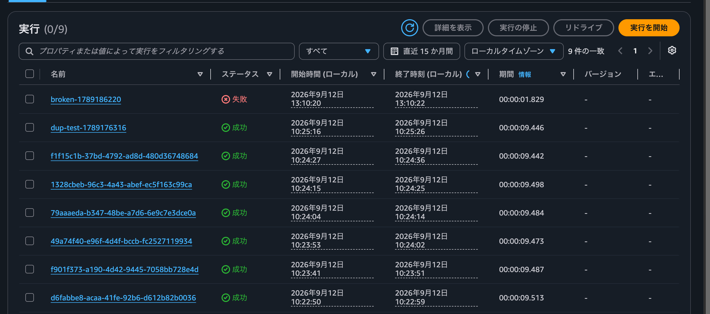
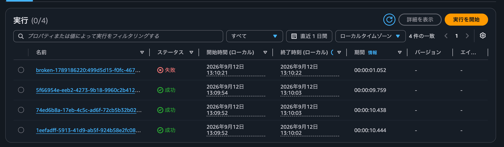
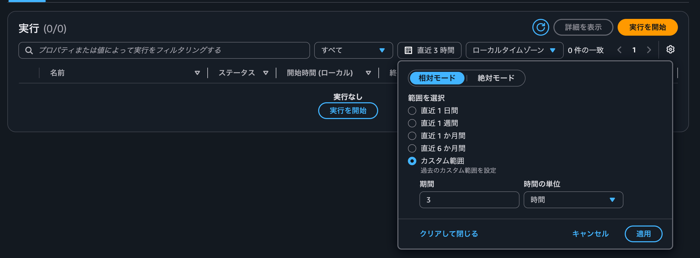
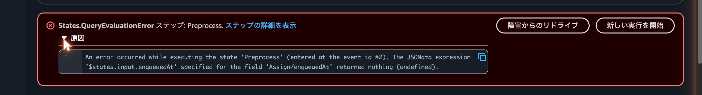
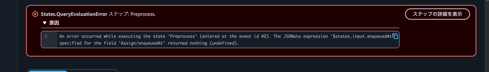
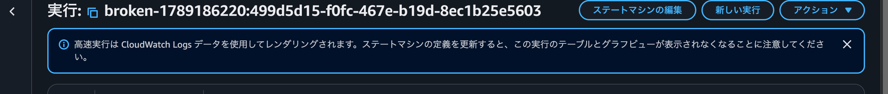
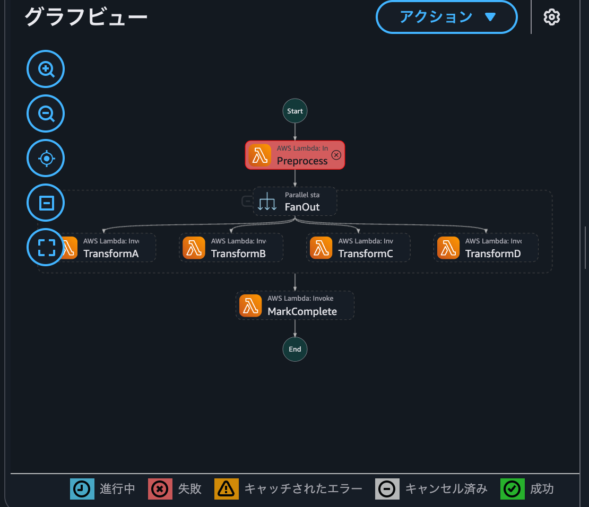

# STANDARD と EXPRESS のコンソール比較

- 実施日: 2026-09-12
- 目的: **市場障害の解析のしやすさ**という観点で、ワークフロー型によるコンソールの差を実機で確認する
- 環境: `ap-northeast-1` / 同一テンプレートを `Prefix` 違いで2スタック

| スタック | Prefix | 型 | ステートマシン |
|---|---|---|---|
| `sfeval-poc` | `sfeval` | STANDARD | `sfeval-workflow` |
| `sfeval-express-poc` | `sfeval-exp` | EXPRESS | `sfeval-exp-workflow` |

比較用に、**両方へ同一原因の失敗実行**を1件ずつ作った（`enqueuedAt` を欠いた入力を直接 `StartExecution`）。

```bash
aws stepfunctions start-execution \
  --state-machine-arn <STATE_MACHINE_ARN> \
  --name "broken-$(date +%s)" \
  --input '{"messageId":"broken","body":"{\"command\":\"process\"}"}'
```

## 結論

**情報量には差がない。差は「目的の実行に辿り着く手間」と「後戻りできない制約」に出る。**

| 論点 | 差 | 内容 |
|---|---|---|
| 表示される情報量 | **差なし** | グラフビュー・エラー原因・イベント一覧まで同等 |
| 検索速度 | **差なし** | Logs Insights クエリは 443〜815ms |
| 既定で目的の実行に辿り着けるか | **差あり** | EXPRESS は既定が直近3時間 |
| 失敗箇所からの再開 | **差あり** | EXPRESS はリドライブ不可 |
| 定義更新後も証跡が読めるか | **差あり** | EXPRESS は読めなくなる |
| 履歴の保持期間 | **差あり** | 90日固定 vs ロググループ設定（本リポジトリは7日） |

当初は「EXPRESS は CloudWatch Logs 検索なので遅く、見にくいのでは」と予想していたが、
**速度と情報量では差が出なかった。** 実際の差は既定値と機能の有無だった。

---

## 差1: 既定の時間範囲が桁違い

これが最も実務に効く差。両方とも実行一覧に時間範囲のドロップダウンを持つが、**既定値が違う**。

### EXPRESS の実行一覧（既定）

```
実行 (0/0)                              ⟳  [ 詳細を表示 ]  [ 実行を開始 ]
┌──────────────────────────────────────────────────────────────────────────┐
│ 🔍 プロパティまたは値によって実行をフィルタリングする │ すべて ▼ │ 🗓 直近 3 時間 │ ローカルタイムゾーン ▼ │ 0 件の一致 │
└──────────────────────────────────────────────────────────────────────────┘
  名前 ▽   ステータス ▽   開始時間 (ローカル) ▽   終了時刻 (ローカル) ▽   期間 ▽   バージョン   エイリアス

                              実行なし
                            [ 実行を開始 ]
```



### STANDARD の実行一覧（既定）

```
実行 (0/9)        ⟳  [ 詳細を表示 ]  [ 実行の停止 ]  [ リドライブ ]  [ 実行を開始 ]
┌──────────────────────────────────────────────────────────────────────────┐
│ 🔍 プロパティまたは値によって実行をフィルタリングする │ すべて ▼ │ 🗓 直近 15 か月間 │ ローカルタイムゾーン ▼ │ 9 件の一致 │
└──────────────────────────────────────────────────────────────────────────┘
  名前                                    ステータス   開始時間      終了時刻      期間
  broken-1789186220                      ⊗ 失敗      13:10:20     13:10:22     00:00:01.829
  dup-test-1789176316                    ✓ 成功      10:25:16     10:25:26     00:00:09.446
  f1f15c1b-37bd-4792-ad8d-480d36748684   ✓ 成功      10:24:27     10:24:36     00:00:09.442
  1328cbeb-96c3-4a43-abef-ec5f163c99ca   ✓ 成功      10:24:15     10:24:25     00:00:09.498
  79aaaeda-b347-48be-a7d6-6e9c7e3dce0a   ✓ 成功      10:24:04     10:24:14     00:00:09.484
  ...（計9件）
```



`リドライブ` と `実行の停止` が STANDARD にだけ並んでいる点にも注目（差2 で詳述）。

| | 既定の時間範囲 | 表示件数（20:23 時点） |
|---|---|---|
| STANDARD | **直近 15 か月間** | **0/9** — 10:22 からの全件 |
| EXPRESS | **直近 3 時間** | **0/0「実行なし」** |

時間範囲の UI は**両方に存在する**。EXPRESS で窓を「直近 1 日間」に広げると **4件すべて戻った**
（`実行 (0/4)` / `4 件の一致`）。**データは失われていない。既定の窓が隠していただけ。**



ドロップダウンの内容（両型で共通）:

```
[ 相対モード | 絶対モード ]
範囲を選択
  ○ 直近 1 日間
  ○ 直近 1 週間
  ○ 直近 1 か月間
  ○ 直近 6 か月間
  ● カスタム範囲   ← EXPRESS の既定はここ（期間 3 / 時間）
      期間 [ 3 ]   時間の単位 [ 時間 ▼ ]
  [ クリアして閉じる ]  [ キャンセル ]  [ 適用 ]
```



### API から裏付けた事実

コンソールが発行したクエリは `describe-queries` に残る。

```bash
aws logs describe-queries --log-group-name /aws/vendedlogs/states/sfeval-exp-workflow
```

```
SOURCE "/aws/vendedlogs/states/sfeval-exp-workflow" START=-10800s END=0s |
    fields @timestamp, @logStream, type
    | filter strcontains(@logStream, "states/sfeval-exp-workflow")
    | sort @timestamp desc
    | limit 20
```

- `START=-10800s` = 3時間。これが既定窓の実体
- `queryDuration`: 443ms / 815ms → **体感できる遅さではない**
- **同一のクエリが STANDARD のロググループにも記録されていた。** つまりこのパネルは型に依存しない。
  「EXPRESS だから Logs Insights を叩くので遅い」という説明は誤り

### 実務上の意味

障害報告が事象の数時間後に上がってくるのは普通のこと。
**EXPRESS は既定のまま開くと「実行なし」に見える。** 毎回窓を広げる操作が挟まる。

---

## 差2: リドライブと実行の停止が無い

一覧のツールバー:

```
STANDARD: [ 詳細を表示 ] [ 実行の停止 ] [ リドライブ ] [ 実行を開始 ]
EXPRESS : [ 詳細を表示 ]                               [ 実行を開始 ]
```

失敗実行の詳細画面のエラーバナー:

```
STANDARD
  ⊗ States.QueryEvaluationError ステップ: Preprocess. ステップの詳細を表示
    ▶ 原因                        [ 障害からのリドライブ ]  [ 新しい実行を開始 ]

EXPRESS
  ⊗ States.QueryEvaluationError ステップ: Preprocess.
    ▶ 原因                                        [ ステップの詳細を表示 ]
```

実画面。STANDARD は「障害からのリドライブ」があり、原因も同じ場所で展開できる。



EXPRESS は「ステップの詳細を表示」だけ。



**EXPRESS には失敗した箇所から再開する手段が無い。** 復旧はメッセージの再投入になる。

---

## 差3: EXPRESS だけに出る警告バナー

EXPRESS の実行詳細ページ上部に常時表示される。

> ⓘ 高速実行は CloudWatch Logs データを使用してレンダリングされます。
> **ステートマシンの定義を更新すると、この実行のテーブルとグラフビューが表示されなくなることに注意してください。**



障害解析の観点ではこれが一番重い。**原因究明中にホットフィックスを当てると、その障害の可視化を失う。**
「調査を終える前にデプロイしてはいけない」という順序の縛りが生まれる。

---

## 差4: 実行名に UUID が付く

```
STANDARD: broken-1789186220
EXPRESS : broken-1789186220:499d5d15-f0fc-467e-b19d-8ec1b25e5603
```

ARN のリソース種別も違う。

```
STANDARD: arn:aws:states:ap-northeast-1:<ACCOUNT_ID>:execution:sfeval-workflow:broken-1789186220
EXPRESS : arn:aws:states:ap-northeast-1:<ACCOUNT_ID>:express:sfeval-exp-workflow:broken-1789186220:499d5d15-...
```

**EXPRESS は実行名の一意性を強制しない**ため、識別に UUID が必要になる。
詳細ページの URL にも `?startDate=1789186221024` が付く（ログ検索のスコープに使う）。

### API での可否

```
$ aws stepfunctions describe-execution --execution-arn <STANDARD の ARN>
{ "status": "FAILED",
  "error": "States.QueryEvaluationError",
  "cause": "An error occurred while executing the state 'Preprocess' ..." }

$ aws stepfunctions describe-execution --execution-arn <EXPRESS の ARN>
InvalidArn: Resource type not valid in this context: express
```

`DescribeExecution` / `GetExecutionHistory` / `ListExecutions` は **EXPRESS では非対応**。
実行 ARN から状態を引く最短経路が使えない。

---

## 同等だった部分

想定より EXPRESS の画面は充実していた。**実行詳細ページはほぼ機能パリティ。**

| 要素 | STANDARD | EXPRESS |
|---|---|---|
| 実行ステータス / ARN / 開始・終了時刻 / 期間 / 状態遷移数 | ✅ | ✅ |
| エラー種別と失敗ステップ名 | ✅ | ✅ |
| 「原因」の展開 | ✅ | ✅ **文言が一字一句同一** |
| グラフビュー | ✅ | ✅ |
| テーブルビュー | ✅ | ✅ |
| Event view / State view / イベント一覧 | ✅ | ✅（イベント 7件） |
| 実行の入力と出力 タブ | ✅ | ✅ |
| CloudWatch Logs へのリンク | ✅ | ✅ |

両方で完全に同一だった「原因」の文言:

```
An error occurred while executing the state 'Preprocess' (entered at the event id #2).
The JSONata expression '$states.input.enqueuedAt' specified for the field
'Assign/enqueuedAt' returned nothing (undefined).
```

EXPRESS のグラフビューも省略なく描画される。失敗した `Preprocess` が赤で示され、凡例まで同じ。



```
                    Start
                      │
              ┌───────▼───────┐
              │  Preprocess   │  ⊗ 失敗（赤）
              └───────┬───────┘
                  FanOut (Parallel)
       ┌──────────┬────┴─────┬──────────┐
   TransformA  TransformB  TransformC  TransformD
       └──────────┴────┬─────┴──────────┘
                 MarkComplete
                      │
                     End

凡例: 進行中 / 失敗 / キャッチされたエラー / キャンセル済み / 成功
```

---

## 本リポジトリの構成で EXPRESS を選ぶべきか

**選ばない。** 得るものが小さく、失うものが大きい。

得るもの:

- ステート遷移のオーバーヘッド削減（約300ms）とコスト減
- ただし加工A の SLA には既に **7.7秒の余裕**がある（[results.md](./results.md)）。300ms は誤差

失うもの:

- **実行名による冪等化**（FR-4 の設計そのもの。EXPRESS は名前で重複排除しない）
- **exactly-once**（EXPRESS は at-least-once。1実行の中でステートが複数回動きうる）
- `GetExecutionHistory` ベースの計測基盤（`verify.sh` / `report.py` が全面書き直しになる）
- リドライブ
- 定義更新後の証跡の可視化

EXPRESS が効くのは「1実行が数百ms で、秒間数千件流れる」形状。
本リポジトリは1実行10秒・SLA に余裕ありなので、形状が合わない。

---

## キャプチャの撮り方

本ドキュメントの画像は `docs/images/` にある。

| ファイル | 内容 |
|---|---|
| `express-list-default-3h.png` | EXPRESS 実行一覧。既定「直近 3 時間」で `実行 (0/0)` |
| `standard-list-default-15mo.png` | STANDARD 実行一覧。既定「直近 15 か月間」で `実行 (0/9)` |
| `express-list-1day.png` | EXPRESS 実行一覧。「直近 1 日間」で `実行 (0/4)` |
| `time-range-picker.png` | 時間範囲ドロップダウンの選択肢 |
| `standard-failed-detail.png` | STANDARD 失敗詳細。「障害からのリドライブ」付き |
| `express-failed-detail.png` | EXPRESS 失敗詳細。リドライブ無し |
| `express-warning-banner.png` | EXPRESS のみ出る警告バナー |
| `express-graph-view.png` | EXPRESS のグラフビュー |

**本リポジトリは public。** ブラウザのヘッダと AWS コンソール右上のアカウント表示には
アカウント ID とコンソールのユーザー名が出るため、**撮影範囲に含めない**。
上記はいずれも「実行」カード・バナー・グラフビュー単位で切り出してあり、
ARN を含む「詳細」カードも範囲外にしている。

撮り直す場合は、Chrome を最前面にしてから画面の矩形を指定して撮ると範囲を制御しやすい。

```bash
osascript -e 'tell application "Google Chrome" to activate'
screencapture -x -R<x>,<y>,<w>,<h> docs/images/<name>.png
```
